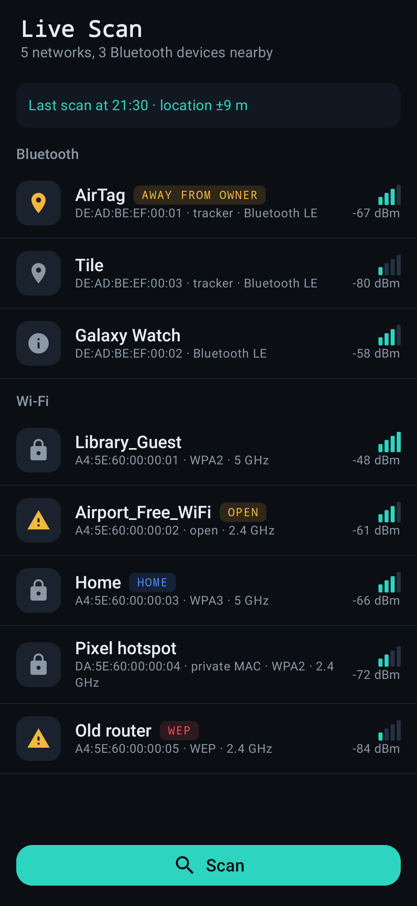
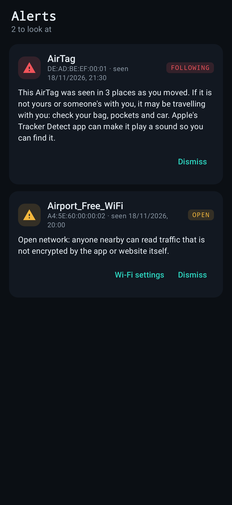
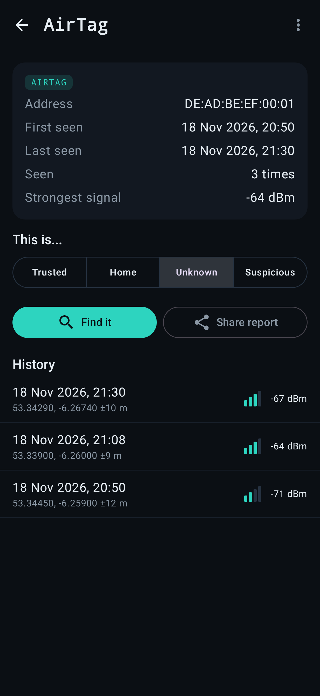
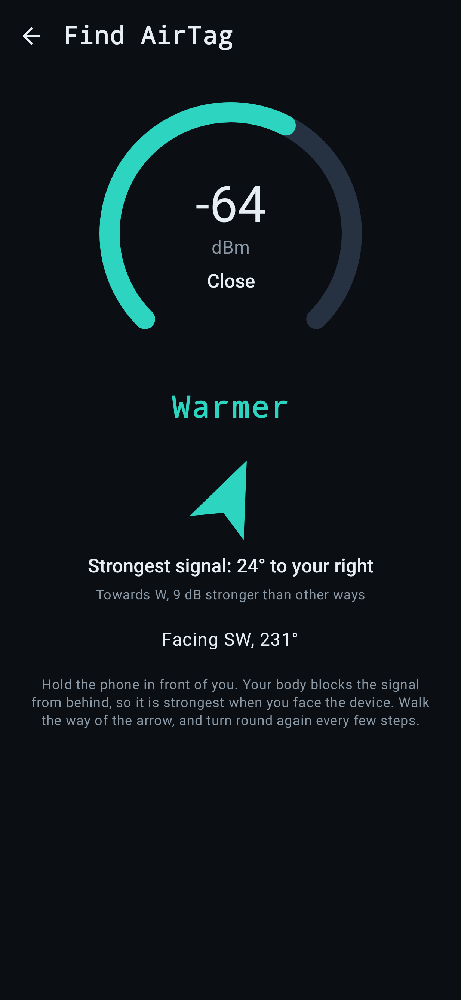
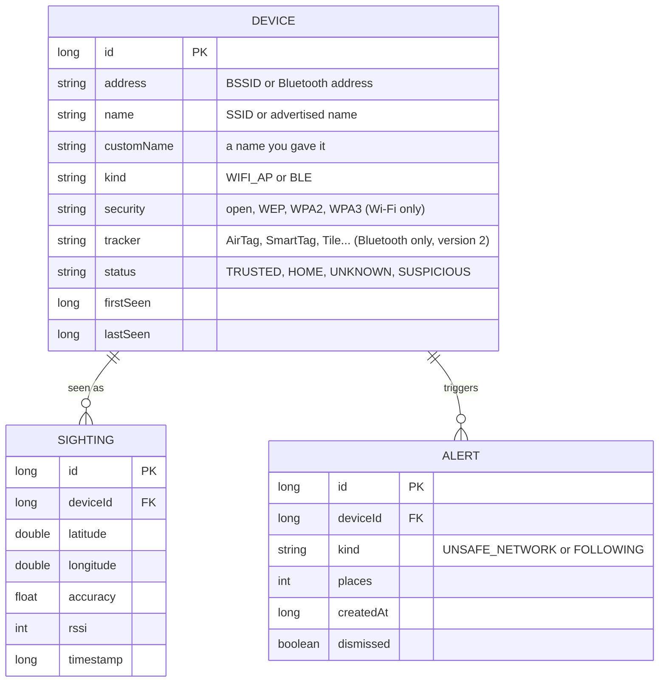

<h1 align="center">Aegis Scanner</h1>

<p align="center">
  <b>Privacy-first Android scanner: maps nearby Wi-Fi networks and Bluetooth devices along your route and flags trackers that keep following you. Listens only, data stays on the phone.</b>
</p>

<p align="center">
  <a href="https://github.com/PeGoPaz/Android-Project-3137418/actions/workflows/android.yml"></a>
  
  
  
  
  
</p>

<p align="center">
  
  
  
  
</p>
<p align="center"><sub>The app's real screens, drawn on the JVM by the screenshot tests from made-up devices on a walk through Dublin city centre - no real networks or places of anyone's. The <a href="docs/mockups">mockups</a> the app was designed from are kept too.</sub></p>

---

## Contents

- [Status](#status)
- [Why Aegis](#why-aegis)
- [What it does](#what-it-does)
- [Roadmap](#roadmap)
- [Timeline](#timeline)
- [Screens](#screens)
- [How tracker detection works](#how-tracker-detection-works)
- [How finding works](#how-finding-works)
- [Battery and Android scan limits](#battery-and-android-scan-limits)
- [Tech stack](#tech-stack)
- [Sensors](#sensors)
- [Data model](#data-model)
- [Permissions](#permissions)
- [Privacy and ethics](#privacy-and-ethics)
- [Known limitations](#known-limitations)
- [Development setup](#development-setup)
- [Project structure](#project-structure)
- [Course context](#course-context)
- [License](#license)
- [Author](#author)

---

## Status

**v1 (Milestone 1) works: Wi-Fi networks.** Scan by button, every scan saved with the phone's GPS location, the map of your route and the networks along it, a page per network with its history and status, alerts for open and WEP networks, trusted devices and settings. Tested on a OnePlus 8T (Android 14).

**v2 (Bluetooth and trackers) is in progress.** Live Scan listens for Bluetooth LE devices alongside Wi-Fi, recognises AirTags and other Find My accessories, Google Find My Device trackers, Samsung SmartTags, Tile, Chipolo and Pebblebee from what they broadcast, and raises a "following you" alert when one keeps turning up where you go. The rules are tested on the JVM and the database on an emulator in CI; it has not met a real tracker on the phone yet. A Find screen walks you to one device: its signal getting warmer or colder, and a compass arrow to where it is strongest.

The project plan was approved, and the scope was revised after lecturer feedback (October 2026). Everything marked *planned* may still change.

Aegis started as the project for the Mobile Development module at Griffith College Dublin (2026/27). The goal is to release it publicly once it is stable.

---

## Why Aegis

The radio around you is invisible. Every phone, watch, pair of earbuds and Wi-Fi router nearby is broadcasting, and you have no easy way to see it.

That matters in two everyday situations:

- **Unwanted tracking.** Small Bluetooth trackers such as AirTags are cheap and easy to hide in a bag or a car. Police reports and news stories have shown them being used to follow people and to find cars to steal.
- **Unsafe Wi-Fi.** Open or WEP-protected networks in cafés, airports and hotels offer little or no protection for your traffic.

Android already shows basic alerts for some unknown trackers. Aegis goes further by keeping a **map of where each device was seen**, so you can look back at your route and judge for yourself - and by checking the **Wi-Fi networks** around you. All of this happens on the phone, without accounts and without Google services.

---

## What it does

1. **Scans** nearby Wi-Fi networks (and, from v2, Bluetooth LE devices).
2. **Saves** every scan with your GPS location in a local database.
3. **Shows** everything on a map: your route, where each scan happened and which devices were around.
4. **Warns** you about unsafe networks and, from v2, about devices that seem to follow you.

Every device gets a status and a colour on the map:

| Colour | Status | Meaning |
|:---:|---|---|
| 🟢 | **Trusted** | Your own devices (phone, earbuds, watch). Never trigger alerts. |
| 🔵 | **Home** | Devices that live at home (router, TV, neighbours' networks). Never trigger alerts. |
| ⚪ | **Unknown** | Everything else. Most devices stay here. |
| 🔴 | **Suspicious** | A device that keeps appearing in different places you go, or one you marked yourself. |

---

## Roadmap

### v1 - Wi-Fi networks *(first target)*

- [x] Project skeleton (Kotlin, Compose, Gradle)
- [x] Manual Wi-Fi scan: name (SSID), BSSID, security type (open / WEP / WPA2 / WPA3), signal strength
- [x] Save each scan with GPS location (Room)
- [x] Map screen with route and network markers (MapLibre + OpenStreetMap)
- [x] Device Detail: history of one network, tag as trusted / home / suspicious
- [x] Alerts for unsafe networks (open, WEP)
- [x] Trusted Devices and Settings screens
- [x] Share report (`ACTION_SEND`) and open Wi-Fi settings (`ACTION_WIFI_SETTINGS`)

### v2 - Bluetooth and trackers

- [x] Bluetooth LE scanning, alongside Wi-Fi on Live Scan
- [x] Recognise common tracker types from their broadcast data, and whether one is away from its owner
- [x] Point out networks with a made-up (private) address, such as a phone's hotspot
- [x] "Following you" detection across places, with alerts (see [below](#how-tracker-detection-works))
- [x] A notification when a device starts following you, which opens its page; it can be turned off in Settings
- [x] Database version 2, migrated from version 1 by Room
- [ ] Try it on the phone with real trackers, and tune the numbers
- [x] Find a device: its signal warmer or colder as you walk, and a compass arrow to where it is strongest (see [below](#how-finding-works)). On a screen of its own rather than on Live Scan, so the scan for one device runs only while you look for it

### v3 - Smarter scanning

- [ ] Trip mode: scans only while you are moving (accelerometer)
- [ ] Measure battery use per hour and tune scan timing
- [ ] Offline map tiles, so the app needs no network at all

### Decided against

- **Hidden camera detection** - a camera connected to a normal Wi-Fi network does not broadcast anything the phone can see, so detection would be unreliable.
- **Magnetometer "metal detector"** - too unreliable to be useful.
- **Anything that transmits or interferes** with other devices. Aegis is and will stay a passive, detection-only tool.

---

## Timeline

The module has three milestones before the final presentation. Each milestone delivers one version.

| Milestone | Delivers | Date |
|---|---|---|
| 1 | **v1** - Wi-Fi networks, map, storage, all six screens | TBD |
| 2 | **v2** - Bluetooth and tracker detection | TBD |
| 3 | **v3** - Trip mode, battery tuning, polish | TBD |
| Final | Working app + presentation | mid-December 2026 |

---

## Screens

| Screen | What it shows | Version |
|---|---|:---:|
| **Map** (home) | Your route, scan points and colour-coded devices | v1 |
| **Live Scan** | Networks and devices from the latest scan, strongest signal first | v1 / v2 |
| **Device Detail** | Where one device was seen, its signal history, status buttons, Share report; Find it, for a Bluetooth device | v1 / v2 |
| **Find** | One Bluetooth device's signal as you walk, warmer or colder, and an arrow to where it is strongest | v2 |
| **Alerts** | Unsafe networks (v1), trackers following you (v2) | v1 / v2 |
| **Trusted Devices** | Add, rename or delete your own devices | v1 |
| **Settings** | Scan frequency, detection sensitivity, Trip mode | v1 / v3 |

---

## How tracker detection works

*Built in v2; the numbers will be tuned on real walks.*

1. **Recognising a tracker.** Each Bluetooth advertisement is read for the formats of the finding networks (`ble/Trackers.kt`): Apple's Find My message (company `0x004C`, type `0x12`) says whether it is an AirTag, another Find My accessory or AirPods, and its length whether the device is away from its owner; Google's Find My Device trackers use their own Eddystone frames (`0x40`, `0x41` once separated); Samsung SmartTag, Tile, Chipolo and Pebblebee are known by their service. The values follow [AirGuard](https://github.com/seemoo-lab/AirGuard) (SEEMOO, TU Darmstadt).
2. **Remembering it.** Every scan stores a **sighting**: which device, where you were, when, and how strong the signal was.
3. **Following you** (`detection/FollowingRule.kt`). A device is following you when, within **12 hours**, it was seen in **3 places at least 200 m apart**, over **at least 10 minutes**. Something that stays put - a router, a shop's beacon - is only ever seen in one place.
   - Devices marked **Trusted** or **Home** never count: that is how your own earbuds, the Wi-Fi on your bus or a friend's phone are kept out.
   - Locations that may be more than 100 m off (from the mobile network rather than GPS) cannot tell places apart and are left out; so are three places passed within a few minutes, which is a drive past.
   - Bluetooth devices are always checked. Wi-Fi networks only when their address is made up - a phone's hotspot - since a strong router can be heard from places far enough apart to look like three.
4. **The alert** says where it was seen and what to do. It also comes as a notification (`notify/FollowingNotifier.kt`), posted once the alert is saved, which opens the device's page; Settings can turn it off. One alert per device stays open; once you dismiss it, it takes another outing with the device to alert again.

**Still open:** trackers and phones change their Bluetooth address from time to time to protect privacy (an AirTag away from its owner about once a day), so the same tracker can come back as a new device. Recognising it across a change is the main research problem left in v2. Using the accelerometer to check that you were moving is planned with Trip mode (v3).

---

## How finding works

*Built in v2; not yet tried with a real tracker.*

On a Bluetooth device's page, **Find it** opens a search for that one device (`ui/find`), its own activity.

1. **Listening to one device.** The scan keeps running with a filter on the device's address, which the Bluetooth chip applies itself, so the phone is not woken for every other device nearby (`BleScanner.follow`). It stops five seconds after the screen goes away: long enough to ride out turning the phone sideways.
2. **Warmer or colder.** Signal strength jumps by 10 dB or more from one advertisement to the next. The meter shows the **median** of the last 4 seconds, and the trend compares it with the 4 seconds before; it says warmer or colder only when they differ by at least 4 dB (`ble/Signal.kt`).
3. **Which way.** A phone's antenna cannot tell where a signal comes from, but the person holding it can: a body soaks up 2.4 GHz radio, so with the phone held in front of you the signal is weakest with the device behind you. Turn slowly on the spot and every reading is paired with the compass heading from the rotation vector sensor (`sensors/Heading.kt`) and put in one of twelve 30° slices. The strongest slice, by its median and at least 5 dB above the rest, is where the arrow points (`ble/Bearing.kt`). There is no arrow until two thirds of the circle have been faced: the only side looked at would always win.
4. **The arrow turns with the phone.** It points at that bearing minus the way the phone faces now, so it keeps pointing the same way while you turn.

Distances are given in words ("close", "a few metres away"), never in metres: walls, bodies and how the device is held change the signal too much for a number to be honest.

---

## Battery and Android scan limits

Constant scanning would drain the battery. Android also does not allow it:

| Scan type | Android limit |
|---|---|
| Wi-Fi, app on screen | 4 scans per 2 minutes |
| Wi-Fi, background | 1 scan per 30 minutes **for all background apps together** |
| Bluetooth LE | Limited number of scan starts in a short period; low-power scan mode available |

So Aegis will:

- scan when you press **Scan**;
- in **Trip mode**, scan only while the accelerometer says you are moving, inside a visible foreground service;
- use Android's **low-power Bluetooth scan mode**;
- never run a hidden, always-on background scan.

> **Dev tip:** Wi-Fi scan throttling can be switched off for local testing in *Developer options → Networking → Wi-Fi scan throttling*.

---

## Tech stack

| Area | Choice | Notes |
|---|---|---|
| Application ID | `tech.vladr.aegis` | |
| Language | **Kotlin** | |
| UI | **Jetpack Compose** (Material 3) | |
| Map | **MapLibre Native for Android** + **OpenStreetMap** data | Open source. Tile source planned: OpenFreeMap. No Google Maps. |
| Storage | **Room** (SQLite) | Local only, kept out of backups and phone-to-phone transfers |
| Settings | **Jetpack DataStore** | |
| Location | Android platform `LocationManager` | No Google Play Services, so it also runs on de-Googled Android |
| Sensors | Android `SensorManager` | Accelerometer, magnetometer (rotation vector) |
| Background work | Foreground service (Trip mode), WorkManager | |
| Build | Gradle (Kotlin DSL) | |
| SDK | `minSdk 31` (Android 12), `targetSdk` / `compileSdk 37` | Android 12+ has the modern Bluetooth permission model |
| Tests | JUnit on the JVM for the rules and view models; Robolectric + Roborazzi screenshot tests of the screens; instrumented tests for the database | CI runs the JVM tests and lint, and the database tests on an emulator, on every push |
| Editor | Neovim (LazyVim) + Gradle CLI | Android Studio is optional |

---

## Sensors

| Sensor | Used for |
|---|---|
| **GPS** | Tagging every scan with a location; drawing the route; spotting a device that appears in several places |
| **Magnetometer** + accelerometer + gyroscope (rotation vector) | The compass of the Find screen: which way the phone faces, for the arrow to a device (v2); turning the map to face the way you walk (planned) |
| **Accelerometer** | Knowing if you are walking or still - for the "following" check and for battery-saving Trip mode |

---

## Data model

All data lives on the phone in a Room database. Three tables:



**CRUD**

The schema of each version is kept in `app/schemas/`; version 2 added the tracker kind, and Room migrates a version 1 database by itself (`MigrationTest` checks it).

- **Create** - devices and sightings are added on every scan; trusted devices can be added by hand.
- **Read** - the map, lists and Device Detail load from the database.
- **Update** - rename a device or change its status.
- **Delete** - delete a device, clear its history, or dismiss an alert.

---

## Permissions

Location and nearby devices are asked for the first time you press Scan; the permissions marked v2 and v3 are not in the app yet. Without the nearby devices permission, Wi-Fi scanning works as before and Live Scan says why there are no Bluetooth results.

| Permission | Why |
|---|---|
| `ACCESS_FINE_LOCATION` | GPS location for every scan. Android also requires it to read Wi-Fi scan results, even on Android 13+. |
| `ACCESS_WIFI_STATE`, `CHANGE_WIFI_STATE` | Start Wi-Fi scans and read the results |
| `BLUETOOTH_SCAN` | Bluetooth LE scanning ("nearby devices"). Declared **without** `neverForLocation`: Aegis does link devices to places, and that flag would also filter some Bluetooth beacons out of the results. |
| `FOREGROUND_SERVICE`, `FOREGROUND_SERVICE_LOCATION` *(v3)* | Trip mode runs as a visible foreground service |
| `POST_NOTIFICATIONS` | A notification when a device starts following you. Asked for on Android 13 and later, with the scan permissions or when the setting is turned on; without it the alert is still in the app. |
| `INTERNET` | Map tiles only |

Android also requires **Location services to be switched on** to return Wi-Fi scan results. The plan is to avoid `ACCESS_BACKGROUND_LOCATION` by running Trip mode as a foreground service that the user starts.

---

## Privacy and ethics

- **Detection only.** Aegis only listens to signals that devices already broadcast. It never connects to, transmits to, or interferes with other devices.
- **Your data stays on your phone.** No accounts, no analytics, no server. Data leaves the phone only when you tap **Share report**.
- **The one network request is map tiles.** The tile server can see which map area you are looking at, but never your scan data. Offline tiles are planned to remove even that.
- **No Google Play Services** and no proprietary map SDKs.
- **Built to protect yourself.** Aegis is meant to help people check whether they are being followed and whether a network is safe to use. Do not use it to track other people, and follow the law where you live.

---

## Known limitations

- A phone can only see devices that **broadcast** something. Devices that stay silent are invisible to Aegis.
- Trackers and phones **change their Bluetooth address**, which makes it hard to recognise the same device over time.
- Android **limits how often** apps can scan Wi-Fi (see [above](#battery-and-android-scan-limits)).
- Signal strength gives only a **rough idea of distance** - walls and bodies change it a lot.
- The Find arrow needs a **slow full turn** with the phone held in front of you; in a small room, reflections off the walls can point it the wrong way.
- **GPS is weak indoors**, so locations inside buildings can be off.
- Many legitimate networks share one name across lots of access points (for example `eduroam`), which makes "fake network" detection noisy. It is not in the current plan.

---

## Development setup

**Requirements**

- JDK 17 or newer
- Android SDK command-line tools with `platform-tools` and `platforms;android-37` (Gradle fetches the rest)
- An Android 12+ phone with USB or wireless debugging enabled (main test device runs Android 14)
- Optional: [`scrcpy`](https://github.com/Genymobile/scrcpy) to mirror the phone screen on your computer

Android Studio is **not** required. The project is a standard Gradle project, so it opens in Android Studio too.

**Build and run**

```bash
./gradlew assembleDebug     # build a debug APK
./gradlew installDebug      # install it on the connected phone
adb logcat                  # read the app's logs
scrcpy                      # mirror the phone screen
```

**Tests**

```bash
./gradlew testDebugUnitTest   # on your computer: the rules, the view models, and the screens drawn by Robolectric
./gradlew lintDebug           # Android lint
./gradlew recordRoborazziDebug   # save the screenshots in docs/screenshots again
./gradlew verifyRoborazziDebug   # fail if a screen no longer looks like its screenshot
# The database tests, on a connected phone. The flag keeps the app installed,
# so the scans already on the phone are not deleted after the run.
./gradlew connectedDebugAndroidTest -Pandroid.injected.androidTest.leaveApksInstalledAfterRun=true
```

GitHub Actions builds the APK, runs the JVM tests and lint, runs the database tests on an Android emulator, and keeps the debug APK as a download on each run. Screenshots are compared only locally: text is drawn slightly differently on macOS and Linux.

---

## Project structure

```text
app/src/main/java/tech/vladr/aegis/
├── AegisApplication.kt   creates the database, scanner, locator and settings once
├── MainActivity.kt       the main screens
├── ui/                   Compose screens, one folder each: map, scan, alerts, settings,
│                         detail (Device Detail) and find (the search for one device), each
│                         its own activity; theme and shared components
├── scan/                 the Wi-Fi scanner, how a network's security is read, private addresses
├── ble/                  the Bluetooth LE scanner, how trackers are recognised, and the
│                         signal maths of finding one: warmer or colder, and which way
├── sensors/              the GPS location and the compass
├── detection/            the rules: unsafe networks, devices following you
├── notify/               the notification for a device following you
└── data/                 Room entities, DAOs, the repository and the settings store
app/src/test/             JVM tests of the rules and view models, and the screenshot tests
app/src/androidTest/      database and migration tests that run on a phone or emulator
app/schemas/              the database schema of each version
docs/screenshots/         the screens, as the screenshot tests draw them
docs/mockups/             the screen designs
```

---

## Course context

Built for the **Mobile Development** module at **Griffith College Dublin**, 2026/27.

| Module requirement | How Aegis meets it |
|---|---|
| 3+ distinct pages | Seven screens (see [Screens](#screens)) |
| Explicit intent | Tapping a map marker or list row opens Device Detail, its own activity (`DeviceDetailActivity.intent`); Find it opens the search for a device (`FindActivity.intent`) |
| Implicit intent | Share report (`ACTION_SEND`), open Wi-Fi settings (`ACTION_WIFI_SETTINGS`), in `ui/Intents.kt` |
| Sensor use | GPS in v1 (`sensors/Locator.kt`); the rotation vector (magnetometer, accelerometer and gyroscope together) as the compass of the Find screen in v2 (`sensors/Heading.kt`); the accelerometer for Trip mode in v3 |
| Storage with CRUD | Room database with three tables: scans create devices and sightings, every screen reads them, you rename and mark devices, and delete a device, its history or everything |

**Feedback received on the proposal** - camera detection may not be implementable, and constant scanning would drain the battery; start with a simpler version that checks nearby networks. The scope was revised accordingly: v1 focuses on Wi-Fi networks, camera detection was dropped, and scanning is event-driven instead of constant.

---

## License

Aegis Scanner is free software, released under the **GNU General Public License v3.0 or later** (GPL-3.0-or-later). See [LICENSE](LICENSE) for the full text.

In short: you can use, study, change and share the code, but any version you distribute, including modified ones, must stay open source under the same license.

---

## Author

**Vladimir Rainov** - [vladr.tech](https://vladr.tech) · [@PeGoPaz](https://github.com/PeGoPaz)
